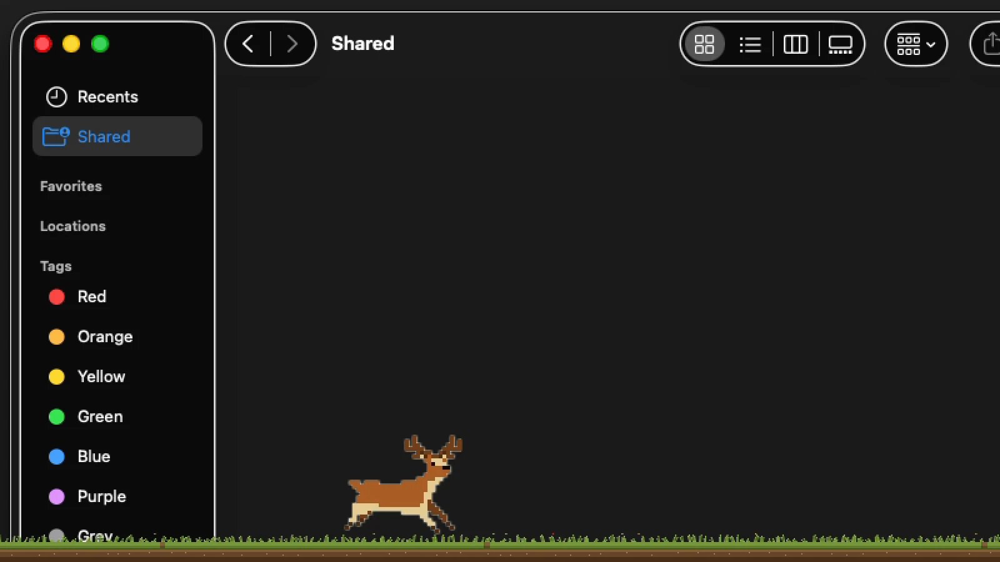

# Desktop Pet

A tiny pixel-art creature that lives on your screen, reacts to what you're doing, and stays out of your way. It comes with living ambient worlds (a meadow, a deep sea, and the Moon) that change with the time of day and the season.



**[acabello.io/products/desktop-pet](https://acabello.io/products/desktop-pet/)** has videos and the full feature list.

## Install

Requires macOS 13 (Ventura) or later on Apple Silicon. Pick one:

### Disk image

1. Download **[DesktopPet.dmg](https://github.com/acabelloj/desktop-pet-releases/releases/latest/download/DesktopPet.dmg)**.
2. Open it and drag **DesktopPet** onto **Applications**.
3. Open DesktopPet from Applications.

The app is not notarized by Apple, so the first time, macOS will refuse to open it. Go to **System Settings → Privacy & Security** and click **Open Anyway**. You only need to do this once.

### Homebrew

```bash
brew install acabelloj/tap/desktop-pet
```

### Shell script

```bash
bash <(curl -fsSL https://raw.githubusercontent.com/acabelloj/desktop-pet-releases/main/install.sh)
```

It downloads the latest release, checks its SHA-256 and signature, and refuses to install if either doesn't match. Read [install.sh](install.sh) first if you like.

Whichever you choose, the pet starts right away and again every time you log in. Look for the 👾 in the menu bar.

## Updates

The pet checks for new releases and updates itself. Every update is verified (checksum and signature) before it is installed. You can turn **Automatic Updates** off in the control panel. Homebrew users can also run `brew upgrade --cask desktop-pet`.

What changed in each version: [CHANGELOG.md](CHANGELOG.md) or the [releases page](https://github.com/acabelloj/desktop-pet-releases/releases).

## Verify a download yourself

Every release file comes with an Ed25519 signature (`.sig`). To check one by hand:

```bash
echo "desktop-pet-releases ssh-ed25519 AAAAC3NzaC1lZDI1NTE5AAAAIDYGbjWPI7digOGVbTkXh6SFtF/AW1P51lZopP4YOABY" > allowed_signers
ssh-keygen -Y verify -f allowed_signers -I desktop-pet-releases -n file \
  -s DesktopPet.dmg.sig < DesktopPet.dmg
```

`Good "file" signature` means the file is exactly what was released.

## Privacy

Chatting with the pet runs entirely on your Mac (macOS 26 or later), so nothing you say leaves it. Pet visits between Macs happen only on your local network. The only thing the pet fetches from the internet is this repository's releases, to check for updates.

## Uninstall

**Disk image:** quit DesktopPet from its menu-bar icon, then drag it from Applications to the Trash.

**Homebrew:**

```bash
brew uninstall --cask desktop-pet
```

**Shell script:**

```bash
launchctl bootout gui/$(id -u)/com.acabelloj.desktop-pet 2>/dev/null || true
rm -f ~/Library/LaunchAgents/com.acabelloj.desktop-pet.plist
rm -f ~/.local/bin/DesktopPet ~/.local/bin/DesktopPet.sig
```

Your settings live in `~/.desktop-pet`. Delete that folder too for a clean slate (Homebrew: `brew uninstall --zap --cask desktop-pet`).

## Feedback and support

Found a bug or have an idea? [Open an issue](https://github.com/acabelloj/desktop-pet-releases/issues).

Desktop Pet is free. If it made you smile, you can [support it on Ko-fi](https://ko-fi.com/acabelloj).

Art credits are on the [product page](https://acabello.io/products/desktop-pet/).
