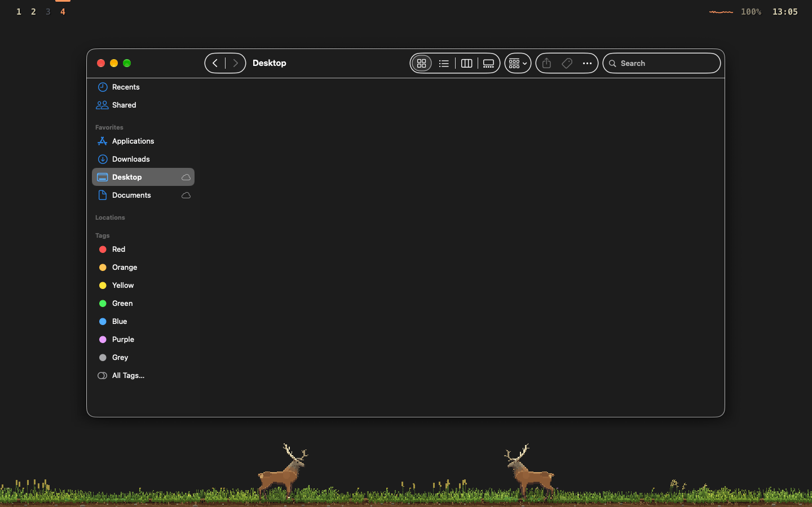
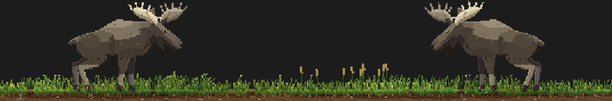
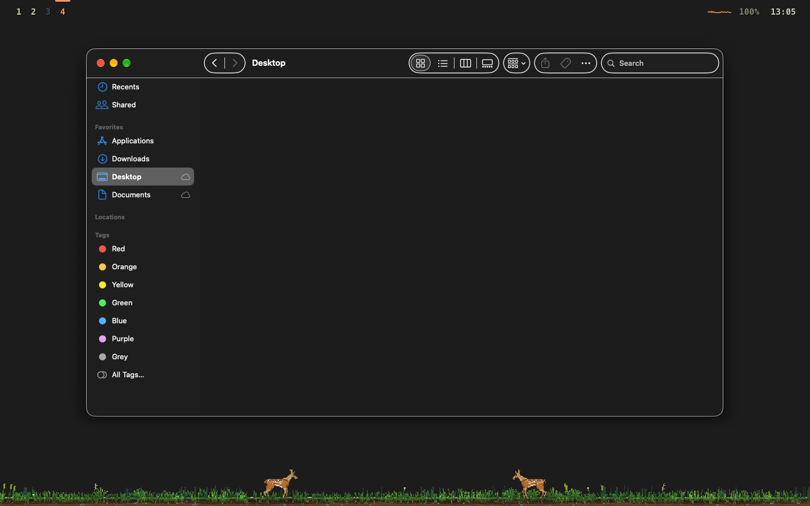
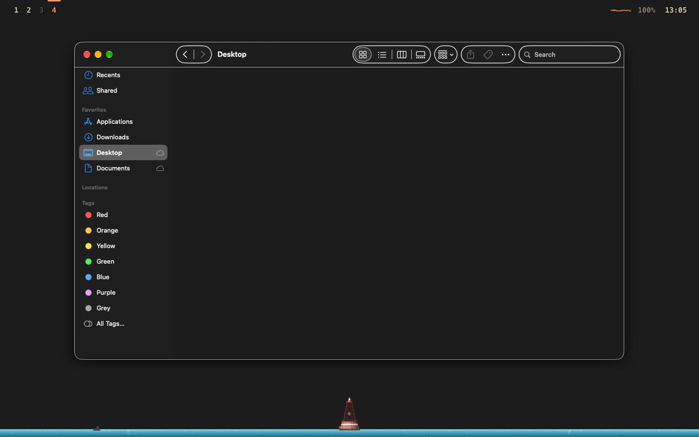
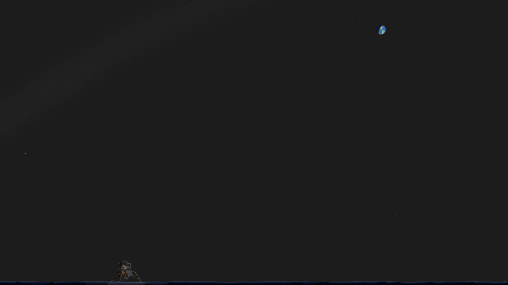
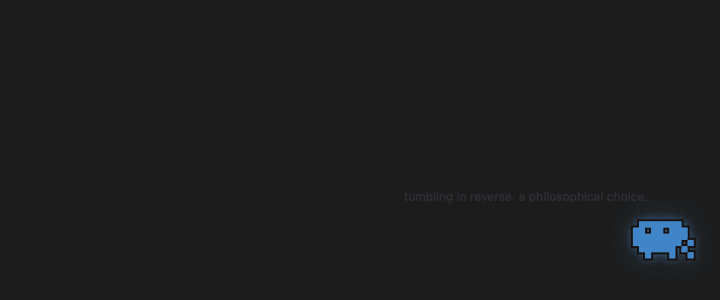

<h1 align="center"></h1>

<strong>A living world along the bottom of your Mac's screen.</strong> 
Wild animals, sharks and astronauts, going about their day while you work.

  <a href="https://github.com/acabelloj/desktop-pet-releases/releases/latest/download/DesktopPet.dmg"><strong>Download for Mac</strong></a>
  &nbsp;·&nbsp;
  <a href="#install">Other ways to install</a>
  &nbsp;·&nbsp;
  <a href="CHANGELOG.md">What's new</a>

It isn't a widget, and it isn't in a window. It runs on your desktop, around whatever you have open. Clicks go straight through to your apps, and there's no Dock icon, just a small menu bar item.

## The meadow

Stags, does, bucks, reindeer and moose wander in and live their own lives. Each one decides for itself based on hunger, tiredness and nerves. They graze, groom, lie down, shy away from your cursor and pass alarm to each other.

Two of a kind may walk up to each other to lock antlers, cuddle or box. Grass grows to its real height, so hooves disappear into it and blades bend around each leg. Shadows follow the sun. Choose how often each animal visits and how many you want at once.

## All four seasons

The world follows the real date where you are. Spring brings fresh grass, flowers and puddles, summer dries it to straw, and winter buries it in snow.

*A whole year, sped up.*

## The sea

Sharks show only their fins, in nine kinds you can pick from, and bolt when your cursor comes near. Gulls pass overhead, and large buoys ride the swell, all at their true size.

## The Moon

A whole month on the Moon, sped up. The Milky Way sweeps across the sky and fades when the Sun comes up. Earth goes through its phases, with city lights on its night side, and meteorites strike the ground, all following the real astronomy.

On your desktop, the sky stays behind your windows, never over them. A lander, a rover and astronauts work on the ground, footprints stay where they're made, and real eclipses happen on their real dates.

## And a pet that puts on a show

A small creature shares your screen, and it's always up to something:

- **Stunts.** Moonwalks, zoomies, a rainbow trail, spins and a victory lap.
- **Daily life.** Lifting weights, dodging the shower, popcorn, naps and a good cry.
- **Sitting on your windows.** It walks along title bars and stays off what you're working on.
- **Playing with you.** Pick it up and throw it, or let it chase your cursor.
- **Talking back.** It comments on all of this, and chat runs entirely on your Mac on macOS 26 or later.

## Install

You'll need macOS 13 or later on Apple Silicon. Whichever way you install, it starts straight away and opens by itself when you log in.

**Disk image.** [Download DesktopPet.dmg](https://github.com/acabelloj/desktop-pet-releases/releases/latest/download/DesktopPet.dmg) and drag it to Applications. It isn't notarized by Apple, so the first time, allow it under **System Settings → Privacy & Security → Open Anyway**.

**Homebrew.**

    brew install acabelloj/tap/desktop-pet

**Install script.**

    bash <(curl -fsSL https://raw.githubusercontent.com/acabelloj/desktop-pet-releases/main/install.sh)

## Updates

It checks for new versions by itself, verifies the checksum and signature before installing, and restarts. You can turn this off.

## Uninstall

**Disk image.** Quit it from the menu bar, then move DesktopPet from Applications to the Trash.

**Homebrew.**

    brew uninstall desktop-pet

**Install script.**

    launchctl bootout gui/$(id -u)/com.acabelloj.desktop-pet 2>/dev/null || true
    rm -f ~/Library/LaunchAgents/com.acabelloj.desktop-pet.plist
    rm -f ~/.local/bin/DesktopPet ~/.local/bin/DesktopPet.sig

---

The animations are the app's own rendering laid over a real macOS desktop, at true size. The year and the month on the Moon are sped up.
