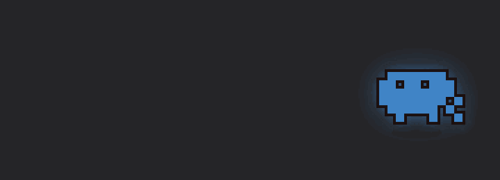
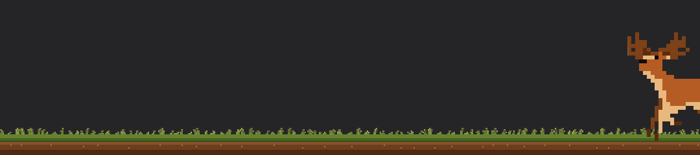
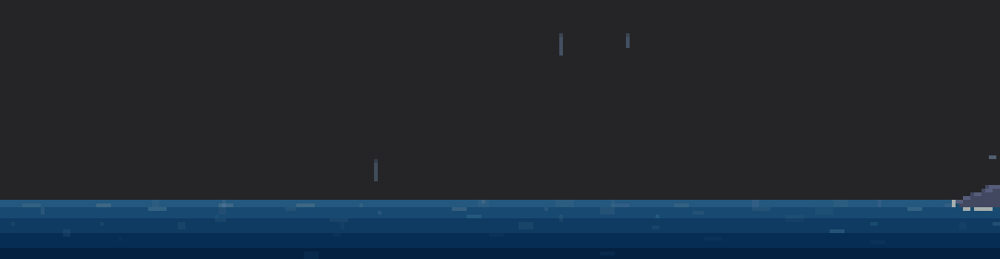
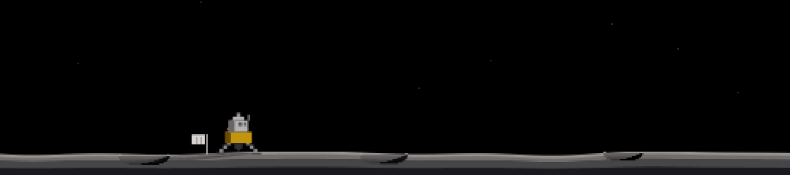

<div align="center">



# Desktop Pet

**A tiny pixel-art creature that lives at the edge of your Mac's screen.**<br>
It wanders, naps on your title bars, plays with your cursor, and chats with you,<br>
while a meadow, a sea, or the Moon comes alive underneath it.

[](https://github.com/acabelloj/desktop-pet-releases/releases/latest) [](https://github.com/acabelloj/desktop-pet-releases/releases) [](#install) [](#install) [](#support)

<br>

<a href="https://github.com/acabelloj/desktop-pet-releases/releases/latest/download/DesktopPet.dmg"></a>

<sub>or <code>brew install acabelloj/tap/desktop-pet</code> &nbsp;·&nbsp; <a href="https://acabello.io/products/desktop-pet/">Website</a> &nbsp;·&nbsp; <a href="CHANGELOG.md">What's new</a></sub>

</div>

<br>

> It is not a widget or a notification. It is a small life that happens at the edge of your screen while you work.

## ✨ What it does

<table>
<tr>
<td width="50%" valign="top">

**🖱️ Pick it up and throw it**<br>
Grab the pet and fling it. It coasts across the screen and settles once it slows down.

</td>
<td width="50%" valign="top">

**🪟 It sits on your windows**<br>
It perches on title bars and window edges, and stays clear of whatever you're working on.

</td>
</tr>
<tr>
<td valign="top">

**🐾 It plays with your cursor**<br>
It darts away when your cursor gets close, then chases the trail you leave behind.

</td>
<td valign="top">

**⚽ Toys with real physics**<br>
It tosses toys that fall, bounce off your window edges and settle around your screen.

</td>
</tr>
<tr>
<td valign="top">

**🎬 Mini-actions**<br>
Zoomies, a moonwalk, a workout, a full-screen football match, a good cry, and more.

</td>
<td valign="top">

**💬 On-device chat**<br>
Talk to your pet. The conversation runs entirely on your Mac (macOS 26+).

</td>
</tr>
<tr>
<td valign="top">

**🔔 Gentle reminders**<br>
Nudges about things like lunch arrive in its speech bubbles, not as notification banners.

</td>
<td valign="top">

**🧬 Two pets**<br>
The wiggly Bacterium or the caffeinated Alien, each with its own moods and way of wandering.

</td>
</tr>
</table>

## 🌍 Three living worlds

Turn on a world and the bottom of your screen becomes a place. Each one follows the real time of day and the season.

<p align="center"></p>

**🌿 Meadow** — A strip of grass that lives through the year. In spring, flowers bloom a few at a time, and butterflies, bees and birds come out when the day is warm.

<p align="center"></p>

**🌊 Sea** — Rain, storms and lightning, gulls, buoys and sharks, and the odd ship on the horizon: a galleon, or the Titanic and its iceberg.

<p align="center"></p>

**🌑 Moon** — A lander, a bleached flag and an astronaut leaving footprints that never fade. Above it, the Earth turns with its city lights on the night side. The eclipses are the real ones, on their real dates.

## 📦 Install

Requires **macOS 13 (Ventura) or later** on **Apple Silicon**. Pick one:

### 💿 Disk image

[Download **DesktopPet.dmg**](https://github.com/acabelloj/desktop-pet-releases/releases/latest/download/DesktopPet.dmg), open it and drag **DesktopPet** onto **Applications**.

### 🍺 Homebrew

```bash
brew install acabelloj/tap/desktop-pet
```

### ⌨️ Install script

```bash
bash <(curl -fsSL https://raw.githubusercontent.com/acabelloj/desktop-pet-releases/main/install.sh)
```

The pet starts right away and again every time you log in. Look for its icon in the menu bar.

> [!NOTE]
> Desktop Pet is not notarized by Apple, so the first time you open it, macOS refuses. Go to **System Settings → Privacy & Security** and click **Open Anyway**. You only need to do this once.

## 🔄 Updates

The pet checks for new releases and updates itself. Every update is verified by checksum and signature before it is installed, and you can turn **Automatic Updates** off in the control panel. Homebrew users can also run `brew upgrade --cask desktop-pet`.

See what changed in each version in the [changelog](CHANGELOG.md) or on the [releases page](https://github.com/acabelloj/desktop-pet-releases/releases).

## 🔒 Privacy

- **Chat stays on your Mac.** It runs on-device, so nothing you say leaves it.
- **Pet visits stay on your network.** Guests from other Macs only arrive over your local network.
- **The only thing it downloads is its own updates**, from this repository's releases.

<details>
<summary><b>🔏 Verify a download yourself</b></summary>

<br>

Every release file comes with an Ed25519 signature (`.sig`). To check one by hand:

```bash
echo "desktop-pet-releases ssh-ed25519 AAAAC3NzaC1lZDI1NTE5AAAAIDYGbjWPI7digOGVbTkXh6SFtF/AW1P51lZopP4YOABY" > allowed_signers
ssh-keygen -Y verify -f allowed_signers -I desktop-pet-releases -n file \
  -s DesktopPet.dmg.sig < DesktopPet.dmg
```

`Good "file" signature` means the file is exactly what was released. The install script does the same check, plus SHA-256, and refuses to install if either doesn't match. [Read it](install.sh) before running it if you like.

</details>

<details>
<summary><b>🗑️ Uninstall</b></summary>

<br>

**Disk image:** quit Desktop Pet from its menu-bar icon, then drag it from Applications to the Trash.

**Homebrew:**

```bash
brew uninstall --cask desktop-pet
```

**Script:**

```bash
launchctl bootout gui/$(id -u)/com.acabelloj.desktop-pet 2>/dev/null || true
rm -f ~/Library/LaunchAgents/com.acabelloj.desktop-pet.plist
rm -f ~/.local/bin/DesktopPet ~/.local/bin/DesktopPet.sig
```

Your settings live in `~/.desktop-pet`. Delete that folder too for a clean slate (Homebrew: `brew uninstall --zap --cask desktop-pet`).

</details>

## 💛 Support

Found a bug or have an idea? [Open an issue](https://github.com/acabelloj/desktop-pet-releases/issues).

Desktop Pet is free. If it made you smile, you can buy it a snack:

<a href="https://ko-fi.com/acabelloj"></a>

<br>

<p align="center"><sub>Made with care by <a href="https://acabello.io/about/">Alejandro Cabello</a> · Art credits on the <a href="https://acabello.io/products/desktop-pet/">product page</a></sub></p>
